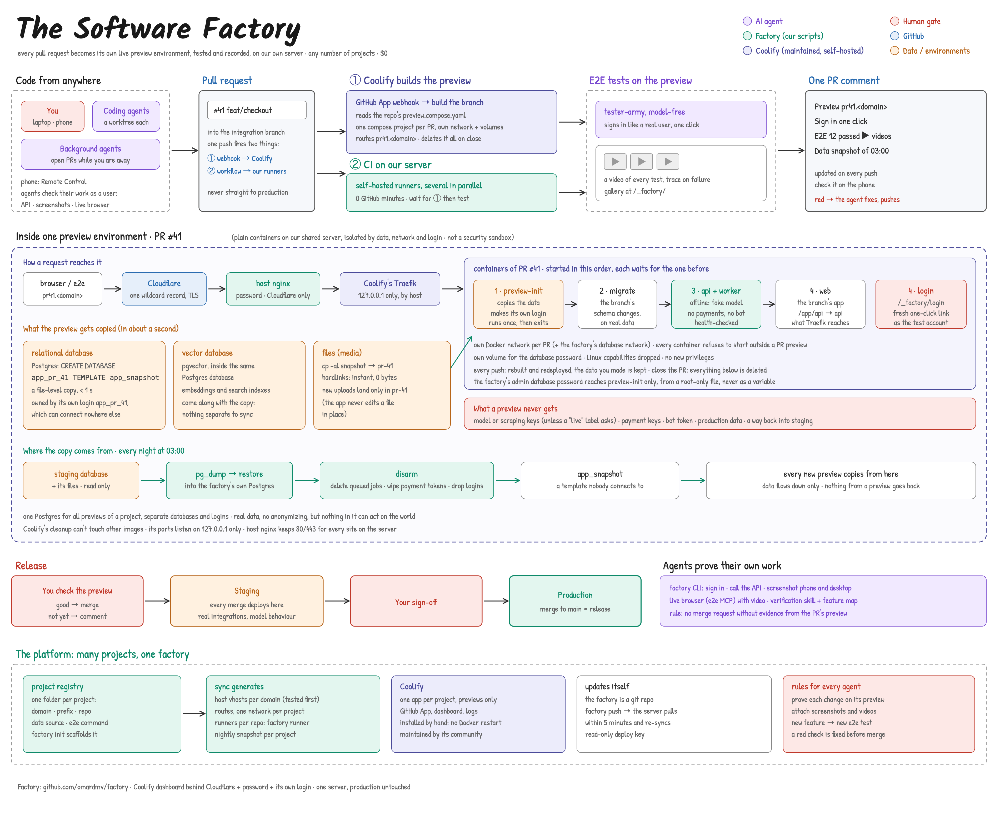

# factory

Our own software factory on the VPS, for every project: each pull request
becomes a live preview with its own copy of the data, e2e tests run against
it with a video of every test, and one PR comment carries the link and the
results. Closing the PR deletes everything. CI runs on self-hosted runners
on the same box, so it uses no GitHub minutes.



Design: [docs/spec.md](docs/spec.md).

## Projects

| Project | Repo | Previews | Prefix |
| --- | --- | --- | --- |
| contentcoach | contentcoach/contentcoach | `pr<N>.contentcoach.org` (Coolify, `preview.compose.yaml` in the repo) | `cc` |

A project is a folder in `projects/`: `project.sh` (domain, prefix, repo,
how to build, how to run e2e, where its data comes from), its
`preview.compose.yaml`, and whatever it needs (a disarm script, a login
helper). Everything on the box is named by the prefix: containers
`<prefix>-pr-<N>-*`, databases `<prefix>_pr_<N>`, network `factory-<prefix>`,
files under `/srv/factory/*/<prefix>/`.

## Who does what

- **Coolify** (box/coolify: manual install, loopback-only ports, Traefik on
  127.0.0.1:18080, cleanup off) builds and runs each PR's preview from the
  repo's `preview.compose.yaml`, routes it, deletes it on close, and is the
  dashboard at https://coolify.contentcoach.org.
- **The factory** keeps what Coolify doesn't do: the nightly disarmed snapshot,
  each preview's own data and DB login (the compose's `preview-init`, admin
  login from a root-only file), the e2e run with videos, the PR comment, the
  data cleanup on close, runners, routing, and the agent tools.

## Onboarding a project

```bash
factory init <name> --domain example.org --prefix ex --repo owner/repo --repo-dir ~/code/repo
# fill in projects/<name>/project.sh + preview.compose.yaml
# Cloudflare: proxied "*" record for the domain; origin cert on the box at
#   /etc/ssl/cloudflare/<domain>.pem and .key
factory push               # the box pulls and generates routes within 5 minutes
factory runner <name>      # a self-hosted runner for the repo
# commit .github/workflows/preview.yml in the repo, open a PR: it previews itself
```

## Agents

`agents/server.mjs` (systemd `factory-agents`) runs each task as Claude Code
in its own locked-down container, on branch `agent/<task>`:

1. **Brief** (skipped for issues, queues and "skip brief"): questions, plan,
   definition of done. You answer once.
2. **Run**: no questions. The agent pauses only with a `DECISION NEEDED`
   block (architecture, money, security, a product call) or before something
   irreversible; everything else it decides and logs in the PR.
3. **Checks**: `[factory]` reports from the preview + e2e drive it to green.
4. **Review**: at a green head (or as soon as the PR exists, for a project
   without previews) a fresh reviewer (`REVIEW_MODEL`, default opus; own
   session, no GitHub token, no edit tools) reads the PR. PASS = ready for
   you; CHANGES = back to the agent. At most 6 rounds, then it stops.

Tasks come from the chat bot or dashboard, from issues labelled
`ready-for-agent` (polled every 2 minutes, one task per issue), or as a
queue (`queue:` + one task per line in Telegram; one summary when the
whole batch has settled). Agents never merge.

## Commands

Laptop (`bin/factory`): `url`, `login`, `api`, `shot` against `staging` or a
PR number, signed in; `init`, `runner`, `push`.

Box (`factory-box`, runs from `/opt/factory/src`, pulled every 5 minutes):
`up`, `e2e`, `down`, `reset`, `snapshot`, `snapshot-all` (nightly 03:00),
`sync`, `runner-add`, `self-update`, `ls`.

## On the box

`/opt/factory` (config, gateway, Node, Chromium, runners, this repo in
`src/`) and `/srv/factory` (preview data, media, artifacts, state). Linux
user `factory` runs the runners. Previews sit behind basic auth (user
`factory`, password in `/opt/factory/preview-password`). Nothing outside
these is touched; the source data of a project is only read.
