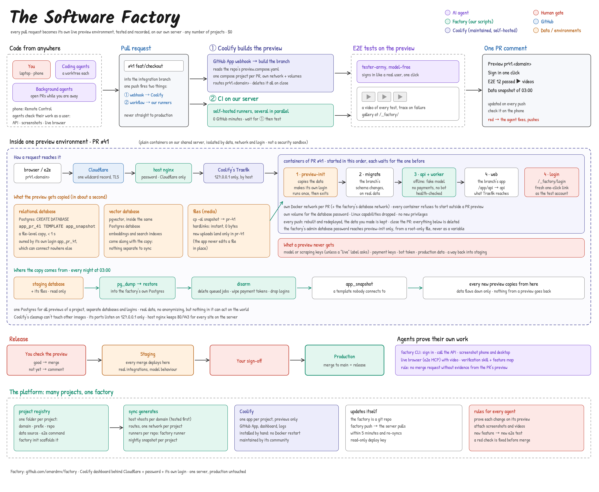

# factory

Our own software factory on the VPS, for every project: each pull request
becomes a live preview with its own copy of the data, e2e tests run against
it with a video of every test, and one PR comment carries the link and the
results. Closing the PR deletes everything. CI runs on self-hosted runners
on the same box, so it uses no GitHub minutes.



Design: [docs/spec.md](docs/spec.md).

## Projects

| Project | Repo | Previews | Prefix |
| --- | --- | --- | --- |
| contentcoach | contentcoach/contentcoach | `pr<N>.contentcoach.org` (Coolify, `preview.compose.yaml` in the repo) | `cc` |

A project is a folder in `projects/`: `project.sh` (domain, prefix, repo,
how to build, how to run e2e, where its data comes from), its
`preview.compose.yaml`, and whatever it needs (a disarm script, a login
helper). Everything on the box is named by the prefix: containers
`<prefix>-pr-<N>-*`, databases `<prefix>_pr_<N>`, network `factory-<prefix>`,
files under `/srv/factory/*/<prefix>/`.

## Who does what

- **Coolify** (box/coolify: manual install, loopback-only ports, Traefik on
  127.0.0.1:18080, cleanup off) builds and runs each PR's preview from the
  repo's `preview.compose.yaml`, routes it, deletes it on close, and is the
  dashboard at https://coolify.contentcoach.org.
- **The factory** keeps what Coolify doesn't do: the nightly disarmed snapshot,
  each preview's own data and DB login (the compose's `preview-init`, admin
  login from a root-only file), the e2e run with videos, the PR comment, the
  data cleanup on close, runners, routing, and the agent tools.

## Onboarding a project

```bash
factory init <name> --domain example.org --prefix ex --repo owner/repo --repo-dir ~/code/repo
# fill in projects/<name>/project.sh + preview.compose.yaml
# Cloudflare: proxied "*" record for the domain; origin cert on the box at
#   /etc/ssl/cloudflare/<domain>.pem and .key
factory push               # the box pulls and generates routes within 5 minutes
factory runner <name>      # a self-hosted runner for the repo
# commit .github/workflows/preview.yml in the repo, open a PR: it previews itself
```

## Agents

`agents/server.mjs` (systemd `factory-agents`) runs each task as Claude Code
in its own locked-down container. The ways of working come from Lauren Tan's
pstack: never block on the human, a playbook per kind of work and a decision
log (`brain/prompts/playbooks.md`), independent review, an audit trail you read in
the morning.

- **change** (branch `agent/<task>`): brief (skipped for issues, queues and
  "skip brief": questions, plan, definition of done) -> run (playbook: bug,
  feature, refactor, performance, investigation, large; decision log in
  `/workspace/decisions.tsv`; pauses only with `DECISION NEEDED` for
  architecture, money, security or a product call) -> checks (`[factory]`
  preview + e2e reports) -> independent QA at a green head (projects with
  `"qa": true`, below) -> review panel (or as soon as the PR exists for a
  project without previews): fresh sessions, no GitHub token, no edit
  tools, one per model and angle (`REVIEW_PANEL`, default
  `opus:correctness,sonnet:evidence`). Every reviewer must pass; CHANGES =
  back to the agent; at most 6 failed rounds (red e2e, QA FAIL, review
  CHANGES) -> auto-merge (below).

**Independent QA** (`qa` in `agents/projects.json`): the agent's own tests
prove the code does what *it* understood; the QA tester proves the product
does what the *task* asked. A fresh session (`QA_MODEL`, default `sonnet`)
with **no checkout, no GitHub token and no edit tools** gets only the task as
the person gave it and the PR's preview. It writes the acceptance criteria
itself, signs in through `/_factory/login`, drives the preview with the e2e
(tester-army) MCP baked into the agent image (`agents/image/qa-tools`,
`qa-mcp`), records a video per check and answers `QA VERDICT: PASS | FAIL |
NOT APPLICABLE`. The report goes on the PR and to Telegram; videos at
`https://pr<N>.<domain>/_factory/qa/<round>-<sha>/` (deleted with the
preview). FAIL goes back to the agent as a failed round, told to turn each
failure into an e2e test; if the agent keeps its code and disputes the
finding, the head goes on to the review panel, which gets the QA report and
judges. Each head is tested once. The image is not rebuilt by self-update:
after a change in `agents/image`, run
`docker build -t factory-agent:latest /opt/factory/src/agents/image` on the box.
- **report** (benny-style triage): classify, find duplicates, reproduce twice
  with the repo's own tools, file or update the issue and label it
  `ready-for-agent` / `ready-for-human` / `needs-info`. A `ready-for-agent`
  issue then becomes a change by itself.
- **program** (orchestrate): a coordinator plans phases of independent
  changes; you approve the plan once ("go"); each phase runs as a batch; when
  you have merged a phase, the coordinator plans the next from what landed,
  until `PROGRAM DONE`.

**The brain** (`brain/`, see its README): the role prompts, playbooks,
knowledge and factory-wide skills every agent gets, on every project.
Read on every run, so a merged change applies without a restart; knowledge
and skills are mounted read-only into each container. New skills land only
with the founder's approval; the safety gates (`brain/knowledge/gates.md`)
never change without the founder.

Tasks come from Slack (`slack/`: one channel per task, archived when its PR
closes), Telegram or the dashboard, from issues labelled
`ready-for-agent` (change) or `needs-triage` (report; issues already labelled
when triage first ran are left alone), polled every 2 minutes, or as a queue.
The queue and the running jobs are on disk: after a restart (every deploy)
an interrupted job resumes its session, told it was interrupted. `/pause`
leaves a work-in-progress commit and a resume note. A summary arrives on
Telegram at 08:00 Tashkent (`/digest` any time).

**Auto-merge** (`autoMerge` in `agents/projects.json`): when the whole panel
passes, the factory merges the PR itself, but only into that one branch
(contentcoach: `dev`, i.e. staging; the factory: `main`), only at the exact
head the panel reviewed (GitHub's sha lock), and only through the branch's
own protection (dev's required checks). A refused merge retries for about
20 minutes, then waits for you. contentcoach `main` (production) is never
merged by the factory: it keeps the staging sign-off. Self-update refuses a
factory commit whose shell, JavaScript or projects.json does not parse.

## Commands

Laptop (`bin/factory`): `url`, `login`, `api`, `shot` against `staging` or a
PR number, signed in; `init`, `runner`, `push`.

Box (`factory-box`, runs from `/opt/factory/src`, pulled every 5 minutes):
`up`, `e2e`, `down`, `reset`, `snapshot`, `snapshot-all` (nightly 03:00),
`sync`, `runner-add`, `self-update`, `ls`.

## Agents

`agents/server.mjs` (service `agents/factory-agents.service`) runs software
agents. A task is one conversation with Claude Code, run headless in a
locked-down container built from `agents/image` (Node, Postgres, Chromium,
`gh`; it clones the repo onto branch `agent/<id>`). The API listens on
loopback and every call needs the API token.

1. **Brief**: read-only. The agent answers once with its questions (or "no
   questions"), a short plan, and a definition of done. It changes no file.
   A task created with `auto` skips this phase.
2. **Run**: after the person answers, the agent works without asking
   anything, pushes `agent/<id>` and opens a PR (Done / Decisions / Attention).
3. **Review**: every push gets a preview and e2e. The results are posted to
   the task as `[factory]` messages, and each one starts another agent turn
   to fix what failed. A ✅ marks the task `review`; after 6 rounds it stops
   and waits for a person.

Tasks live in `/srv/factory/agents/tasks/<id>/`: `task.json` (phase, status,
rounds) and `messages.jsonl` (the conversation). Secrets stay in
`/opt/factory/agents`.

## On the box

`/opt/factory` (config, gateway, Node, Chromium, runners, this repo in
`src/`) and `/srv/factory` (preview data, media, artifacts, state). Linux
user `factory` runs the runners. Previews sit behind basic auth (user
`factory`, password in `/opt/factory/preview-password`). Nothing outside
these is touched; the source data of a project is only read.
